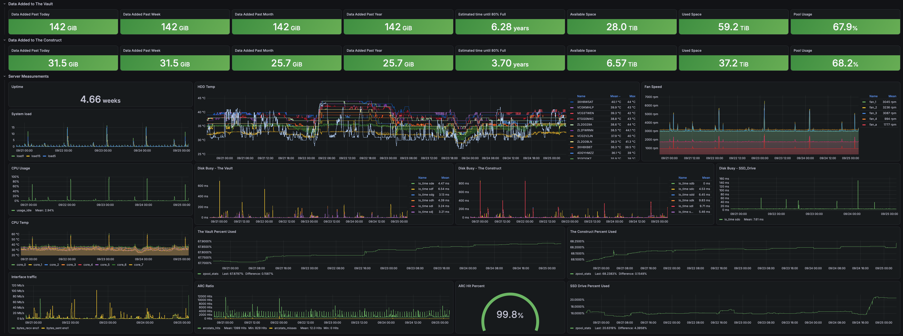

# Telegraf on TrueNAS Scale

#### Introduction
This is a simplified and refined way of getting the data from a TrueNAS Scale server extracted by Telegraf onto a InfluxDB instance and then viewed with Grafana. [Original Post](https://reddit.com/r/homelab/comments/13rxlux/telegraf_on_truenas_scale/)

This repo will not go into the ins and outs of building docker containers, hosting them in a personal repository, enabling insecure registries in TrueNAS, or installing custom-apps inside of TrueNAS. But those are what I ended up doing to run this on my system. 

#### Current Versions
- Telegraf: 1.40
- InfluxDB: 2.9.3
- Grafana: v13.1.3
- TrueNAS Scale: 25.04.2.6

#### Included in this repo
1) Dockerfile used to build the custom Telegraf image
2) Example Telegraf config to populate the dashboard
3) The Grafana dashboard json export used in the picture displayed below
4) A docker compose file that can be used to run the image manually on the TrueNAS system
5) A setup script that is no longer needed but is included in case you want to mount less volumes into the container. 

